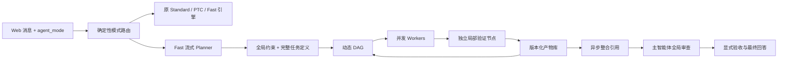

# 极速模式（Fast Mode）

## 使用与报告入口

极速模式的会话标识为 `fast_dag`，使用流式规划、动态 DAG、并发 Worker、独立局部验证和最终主审。它与旧 `fast` 模式分开，复用当前模型、思考强度、工具和审批机制。

本文件只说明架构、配置和使用方式。唯一的当前测试与性能报告是 [Fast 当前报告](fast-current-report.md)。历次报告、原始数据、时间线、测试日志和截图已统一移至 `G:\测试数据存档\neutrino-fast`，以归档清单中的版本和日期为准。每个场景的五轮实测、中位数、平均数和样本方差见 [逐轮数据与统计](fast-current-report.md#逐轮数据与统计)。

## 架构与执行边界

| 项目 | 标准模式 `standard` | 新增极速模式 `fast_dag` |
| --- | --- | --- |
| 路由 | 原有 `runTaskTurn` 分支 | 独立 `FastAgentEngine` |
| 规划 | 原有完整规划与顺序步骤 | JSONL 流式发布完整任务，先发布全局约束 |
| 执行 | 原 Agent 循环、原子智能体 | 动态 DAG 与有界 Worker Pool |
| 推进 | 原步骤执行策略 | 必需前驱通过验证后立即解锁后继 |
| 验证 | 原机制保留 | 独立局部验证节点 + 主智能体最终全局审查 |
| 模型、推理 | 原选择和档位 | 完全复用同一模型、档位和输出预算 |
| 工具、安全 | 原审批、权限、预算、取消 | 复用原接口和 TaskRuntime，审批串行呈现 |
| 上下文 | 原压缩和历史策略 | 同一容量与压缩实现，另加版本化上下文/产物 |

旧 `ptc`、旧 `fast` 和 `/pro` 执行分支及提示词继续存在。`fast_dag` 不使用旧 `fast.txt` 的精简推理提示词。



Planner 仅在目标、依赖、上下文、验收标准、输出契约和访问范围完整后发布任务。调度器支持前向依赖、优先级、环检测、动态依赖更新、失效传播和版本绑定。
初始规划可使用 `single` 声明，由运行时将不可变原始请求完整展开为工作任务及独立验证器，省去模型重复改写；复杂任务继续使用 DAG，省略的传输默认字段由程序补齐，语义字段与权限仍完整校验。恢复协议按需载入。
相似 DAG 任务可以共享传输字段，由程序复制为完整定义后继续原验证。小型原始证据直接内联；大型证据使用带状态、版本与摘要的索引，并通过 `read_task_evidence` 读取精确原文。合法祖先证据沿已声明依赖及匹配输入版本提供；失效或无关产物不可借此读取。完整请求、结论、假设、必要独立检查和最终审查都保留。恢复可继承已发布约束；缺失初始目标、后置约束仍拒绝，历史规划错误和未完成节点预算保留。
状态为 `PENDING / READY / RUNNING / VERIFYING / VERIFIED / FAILED / BLOCKED / INVALIDATED / COMPLETED`。
每个工作任务有独立 `.verify` 节点；后继任务等待已验证产物，而不是仅等待模型返回文本。
规划任务可声明 `kind: work`（默认）或 `kind: verification`。本地检查集中在工作任务的验收标准中，由独立 `.verify` 执行；有新增覆盖的跨任务检查可直接以 `verification` 执行，不再生成嵌套验证器。显式验证必须依赖已验证产物，并提供明确的通过结论和空的未解决项。最终审查也必须引用这些检查产物。

验证 Worker 使用独立的 Fast Worker 循环，继承原模型客户端、子智能体提示词、上下文容量、轮次、权限和审批规则。
只读自动验证器可在首个模型请求前，通过原审批及工具入口重新读取父任务实际读取的小型源文件（最多 4 个，预检合计 8,192 字节）。资格依据是运行时记录的生产作用域和准确父版本；文件过大、来源不明、越界或无法确认时沿用原循环。新读取属于验证器自己的独立证据，不复用旧内容，也不生成通过结论。
运行时提示可将重复的当前上下文版本哈希无损提取为共享字典，持久化和实际版本检查不变。协调验证器还可直接收到已声明依赖、版本匹配的完整上游工作报告，整组最多 12,000 字节；大型报告继续通过有界证据工具读取。所有独立验证发现、结论和假设保持可用。
`finish_task` 负责提交机器可读结果；验证必须提供显式布尔结论。
漏填字段时在同一私有上下文中纠正，不重跑已完成的写入。
历史上出现过失败检查时保留全部失败证据，并允许纠错后重新验证；未解决问题、拒绝的操作和预算耗尽不能冒充成功。

最终主智能体使用原模型和不受子智能体轮次限制的执行循环。它可继续推理、调用工具、解决冲突和补齐全局检查。
`finish_fast_review` 要求引用当前有效版本的产物，且全部任务通过验证、未解决问题为空，才能记录完成。
伪造引用、旧版本引用和无显式验收的文本回答均不能将任务标记为完成。

当原始用户请求明确要求仅在当前夹具/工作目录内操作时，TaskRuntime 在所有后代工具入口预检路径及可解析 Node 文件 API 参数，并解析符号链接。路径误填会记录未执行证据并允许本轮纠正；真实安全或人工拒绝仍阻止完成。此静态预检不是任意动态程序的操作系统沙箱。

Fast 的破坏性工具提议可先在不执行、不请求人审的情况下改为满足原要求的无破坏性方案；必要操作通过 `request_user_approval: true` 调用原有审批，字段不是用户同意。原始完整授权与极高风险自动审批开关继续生效，未减少独立审批轮次。验证只检查原始验收与实际缺陷，不为未要求交付的辅助脚本另造“验证验证器”义务。

## 并发、权限与恢复

- 模型推理、工具 I/O、后台整合分别使用资源池，初始额度分别为 4、8、2。
- Worker 上限默认是模型槽位的两倍；实际模型请求仍受模型池上限约束。
- API 限流通知会降低本轮模型并发，最低为 1；不切换模型、不降低推理档位。
- 相互独立的只读任务可并行；相互独立且路径不重叠的编辑可并行。
- 任意 shell 命令使用独占工作区访问；有路径限制的编辑不能执行任意 shell，也不能越过其读写范围。
- 读写路径按真实文件系统路径解析，避免符号链接把重叠路径伪装成独立路径。
- 审批仍使用原审批门。多个 Worker 的人类审批串行呈现，避免覆盖同一审批横幅；自动审批也遵循原规则。
- 每个 Worker 和规划请求都有超时；取消传播给排队请求、模型流、工具和进程，调度器等实际操作退出后释放访问范围。
- 自动重试仅适用于安全的只读任务；已启动的写入任务失效后需要显式修复任务。
- `repair` 用新任务处理现有部分状态，再按原任务验收标准重新验证，不重复执行原写入。
- 规划异常与局部失败可在独立的有界次数内重规划；正确产物保留。不会静默切换到 Standard。
- 余额不足、鉴权失败等永久模型错误会明确透传，并停止新的模型请求与重规划；不会把接口错误文本误当成规划 JSON。

动态任务的 `dependencies / required_context / input_versions` 必须一致。输入版本不匹配时阻塞并要求重新规划；失效结果不会解锁后继。
投机执行没有启用。默认继承原 `task_max_*` 共享配额；规划还会为局部验证和恢复预留智能体容量，避免按 Worker 数量误算预算。

## Web、消息与持久化

现有输入框的模式菜单新增「极速模式」卡片，英文标识 `Fast Mode`，保留 Standard、PTC、旧 Fast 和 Pro。
菜单继承原布局、悬停、点击、方向键、Home/End、Escape 与焦点行为；选中卡片有边框、背景和勾选状态。
移动端沿用现有响应式宽度与可滚动菜单。

普通工作区发送消息时携带：

```json
{"text":"用户任务", "agent_mode":"fast_dag"}
```

后端在提交消息的同一个同步操作中校验并选择模式。未知模式返回 400，不追加用户消息。
旧客户端可继续只提交 `text`，沿用会话模式；旧数据缺少模式时默认 Standard。
自然语言里出现「极速模式」不会改变模式。

`agentMode` 表示下一轮选择，`activeAgentMode` 冻结当前轮。排队消息也冻结其提交模式。
运行时改选模式不会修改正在执行的策略。任务快照额外记录 `execution_mode`，Fast 运行记录明确标注 `actual_mode: fast_dag`。

会话保存 `agent_mode` 和 `fast_run`，沿用现有会话刷新恢复逻辑。
每轮另有独立目录：

```text
<sessionDir>/tasks/<sessionId>/fast/<runId>/
  artifacts.json   # 稳定上下文、历史版本和验证状态
  run.json         # 实际 DAG、状态、整合引用、审查记录和指标
```

文件通过临时文件和重命名原子更新；不同轮次和会话使用不同 UUID。
进程重启后不会把磁盘中的 RUNNING 当成活 Worker，也不会自动重放工具。恢复时提示检查部分状态，再由新一轮规划处理。
失败后可显式点击「选择标准模式继续」；该操作只选择后续执行策略，不伪装成极速模式成功。

进度来自同一引擎快照，经原 SSE 通道展示。规划、并发执行、验证、整合、审查、取消与完成均来自实际状态；进度展示没有额外模型调用。
标准模式继续使用原进度显示，旧 Fast 运行记录不会覆盖当前 Standard 的状态。

## 配置与回滚

在现有普通工作区配置中设置以下字段；全部为新增可选字段：

| 字段 | 默认值 | 作用 |
| --- | --- | --- |
| `fast_mode_enabled` | `true` | 新模式 Feature Flag |
| `fast_model_slots` | `4` | 推理并发，最大 16 |
| `fast_tool_slots` | `8` | 工具并发，最大 32 |
| `fast_background_slots` | `2` | 异步整合并发，最大 8 |
| `fast_worker_slots` | 推理槽位 × 2 | 活动任务上限，最大 32 |
| `fast_task_timeout_ms` | `1800000` | 单 Worker / 规划请求超时 |
| `fast_max_tasks` | `24` | 规划任务总上限（工作或显式验证），另受共享配额约束 |
| `fast_retries` | `1` | 安全只读重试，0 可关闭 |
| `fast_replans` | `2` | 有界重规划，0 可关闭 |

关闭新任务入口可设置 `fast_mode_enabled: false`，或启动进程时设置 `NEUTRINO_FAST_MODE=0`。
已有运行冻结其配置，不受新选择影响；需要停止时使用原 Pause。关闭后 Web 卡片不可选，显式提交新模式返回错误，不自动改模式。
旧会话和已有产物无需迁移或删除，恢复标志后仍可查看。

Git 开发分支保留原始提交作为回滚点。工作区还有并行插件开发，撤回代码时应只撤回 Fast 增量，避免覆盖其他工作；关闭 Feature Flag 是无需撤回其他代码的回退方式。

多输入任务的独立验证器会收到生产任务的原始命令和程序正文，按执行顺序检查。证据太大时可按 ID 读取；验证通过前，验证器必须取得尚未交付的生产操作记录。最终主审优先接收末端任务和验证器的完整程序记录，超过内联上限的记录保留索引。主审须引用当前已验证的工作和独立检查产物。失败和拒绝记录保留用于诊断；它们不能充当成功凭据。

验证器在一批工具返回后对照原验收项判断是否可以结束。需要补查时，工具调用说明应写清尚缺的证据或实际矛盾。验证器重新读取已内联的生产文件正文时，只有成功读取且文本完全相同，才可能用该写入记录的 ID 传递正文。新的读取 ID 和完整原文仍进入账本，变更的文本直接返回。

## 测试、性能与指标

```sh
npm run test:fast
```

本地回归在临时夹具内运行，不依赖归档盘。历史真实模型记录的重放是显式的归档审查，使用 `--input` 与 `--data-dir` 指定数据；它不会调用模型。具体结果、版本和复核入口见 [当前报告](fast-current-report.md)。

测量、诊断和截图脚本的默认输出已移出项目：`--data-dir` 优先于 `NEUTRINO_FAST_DATA_DIR`，未设置时使用系统临时目录下的 `neutrino-fast-data`。原始归档位于数据根目录的 `docs/`，新生成结果写入 `generated/`，不会覆盖原始快照。脚本原有的显式 `--output` 等参数继续有效。G 盘未挂载到 WSL 时，应使用 Windows Node 访问 `G:\测试数据存档\neutrino-fast`，或指定已挂载且可访问的数据根目录。

可选浏览器检查仍为 `scripts/test-fast-browser.mjs`，通过 `NEUTRINO_PLAYWRIGHT_MODULE` 指向已有 Playwright 安装；截图同样写入外部数据目录。

实时指标按规划、Worker、验证和最终整合统计输入/输出 Token、逻辑请求、重试、工具等待和调度耗时。旧的 `verification` 聚合可能包含自动审批，角色拆分以原始时间线为准；并行耗时不能相加当作墙钟时间。缺失 usage 保持未知，供应商缓存输入仍计入 Token，不从本地缓存命中推算费用。

设置 `NEUTRINO_DIAGNOSTICS_DIR` 可为运行启用默认关闭的本地元数据 JSONL。它不保存原始正文和凭据，诊断记录也应选择项目外的数据目录。

## 当前实现边界与未完成验收

- 50% 是性能验收目标，是否达到以真实模型报告为准。调度器的定时器基准不代表 Agent 端到端加速。
- 流式规划期间可以新增任务和更新依赖；失败后的模型重规划在当前一波调度结束后执行。正常后继仍在前驱验证通过后立即启动，不等待其他独立分支。
- 后台整合持续合并已验证的产物版本引用，供后续规划和主智能体读取。语义冲突由最终主智能体完整推理处理；当前没有额外的后台语义审查模型。
- 工作区访问范围在同一次 Fast 运行内协调，不是跨进程文件锁或操作系统沙箱。外部程序或另一个会话对同一目录的修改仍需用户协调。
- 重启恢复保留历史、产物与失败原因，不会恢复已消失的进程或自动重放写入。后续一轮根据实际磁盘状态重新规划。
- 大型真实项目、开放式答案人工评审、公网多站点检索及统计可靠的 P95 尚未验收；受控样本的自动断言不能替代这些评测。
- 每轮按同一场景、同一轮的 Standard 计算。双方完整验收且 usage 齐全时，Fast 用时更短允许总 Token 最多为 Standard 的 2 倍，用时持平或更长允许最多为 1.05 倍。配对报告另列质量失败和用量未知。最新实现及独立活动明细见 [当前报告](fast-current-report.md)。

## 代码与测试入口

- Fast 引擎与执行：`src/fast/`。
- 规划协议：`assets/fast-planner.txt`、`assets/fast-replanner.txt`。
- 会话与路由：`src/web/session.ts`、`src/web/server.ts`、`src/web/hub.ts`。
- 原始工具、权限、预算、审批与取消：`src/llm/`。
- 本地回归：`scripts/test-fast-*.mjs`。
- 数据目录与归档引用解析：`scripts/fast-data-paths.mjs`。
- 当前验收与性能结论：[Fast 当前报告](fast-current-report.md)。
